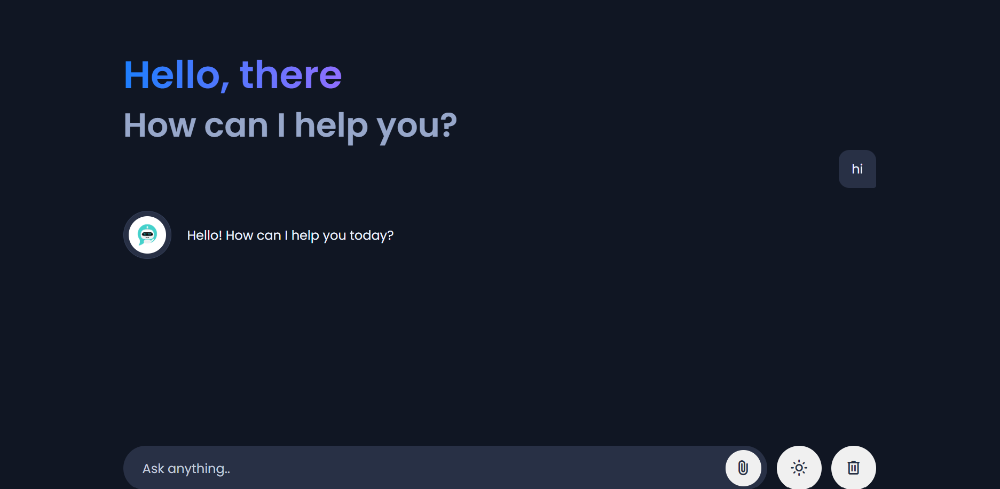
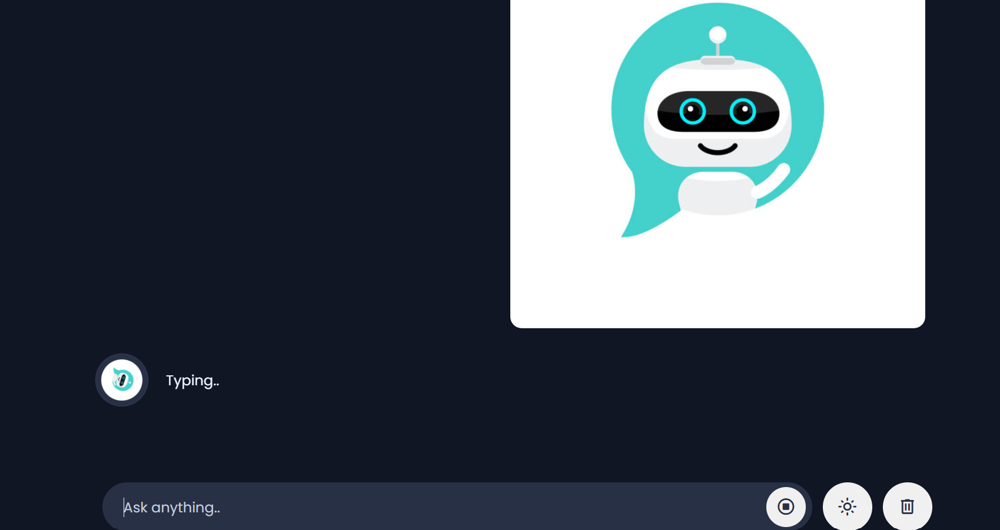
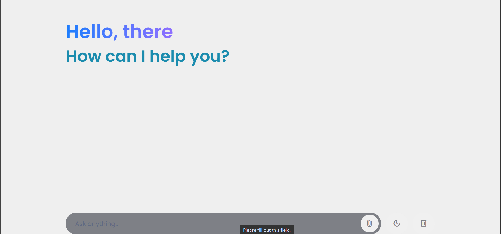

# 🤖 AI Chatbot Using Gemini API

## 📌 About the Project

AI Chatbot is a web-based conversational application developed using HTML, CSS, JavaScript, and the Google Gemini API.

The chatbot allows users to interact with an AI assistant in real time by entering questions and receiving AI-generated responses. It provides a simple, interactive, and user-friendly interface with support for file attachments and image uploads.

The application integrates the Gemini API to process user queries and generate intelligent responses. It also includes features such as conversation history, typing animation, dark and light themes, and response generation control.

The main objective of this project is to develop an interactive AI-powered chatbot that makes communication with artificial intelligence simple and convenient.

## 🛠️ Technologies Used

- 🌐 HTML5 – Structure of the chatbot application.
- 🎨 CSS3 – Styling, layouts, animations, and responsive design.
- ⚡ JavaScript – Application functionality and DOM manipulation.
- 🤖 Google Gemini API – AI-powered conversational responses.
- 🔗 Fetch API – Sending requests and receiving responses from Gemini.
- 📂 FileReader API – Reading and processing uploaded files.
- 💾 LocalStorage – Saving the user's theme preference.
- 🔤 Google Fonts – Typography and visual appearance.
- 🎯 Material Symbols – Icons for chatbot controls.

## ✨ Features

- 🤖 **AI-Powered Conversations:** Generates intelligent responses using the Google Gemini API.
- 💬 **Real-Time Interaction:** Allows users to send messages and receive AI-generated responses.
- 📎 **File Upload:** Supports attaching images and documents to conversations.
- 🖼️ **Image Upload:** Allows users to upload images for AI-based interaction.
- 📄 **Multiple File Formats:** Supports image files, PDF, TXT, CSV, and DOC attachments.
- ⌨️ **Typing Animation:** Displays AI responses with a word-by-word typing effect.
- 🌓 **Dark and Light Mode:** Allows users to switch between dark and light themes.
- 🛑 **Stop Generation:** Provides an option to stop the AI response while it is being generated.
- 🗑️ **Clear Chat:** Allows users to delete the current conversation.
- 📜 **Conversation History:** Maintains previous messages during the active conversation.
- 📱 **Responsive Interface:** Provides a clean and user-friendly chatbot design.
- 💾 **Theme Preference:** Saves the selected theme using browser LocalStorage.

## ⚙️ Working Principle

1. The user opens the AI chatbot application in a web browser.
2. The chatbot displays a welcome screen with a message input field.
3. The user enters a question or message in the input field.
4. The user can optionally attach an image or supported document.
5. JavaScript captures the user's message and uploaded file information.
6. The application sends the conversation history to the Google Gemini API using the Fetch API.
7. The Gemini API processes the request and generates an AI response.
8. The generated response is displayed in the chatbot interface with a typing animation.
9. Previous messages are maintained in the conversation history for continued interaction.
10. The user can continue chatting, switch themes, upload files, or stop response generation.

## 🧠 API Integration

This project uses the Google Gemini API to generate AI-powered responses.

**API Used:** Google Gemini API

The application sends HTTP POST requests to the Gemini API with the user's message and conversation history.

The API request includes:

- User's message.
- Previous conversation messages.
- Uploaded file data, when available.

The API returns an AI-generated response, which is displayed dynamically on the chatbot interface.

## 📂 Project Structure

```text
AI-Chatbot/
│
├── index.html          # Main HTML structure
│
├── style.css           # Chatbot styling and themes
│
├── script.js           # JavaScript functionality and API integration
│
├── robot.jpg           # Chatbot avatar image
│
├── 1.png               # Chatbot interface screenshot
│
├── 2.png               # Chatbot interaction screenshot
│
├── 3.png               # Light theme screenshot
│
└── README.md           # Project documentation
```

## 📸 Project Screenshots

### 🌙 Dark Theme – Chatbot Interface



### 🤖 AI Chatbot Interaction



### ☀️ Light Theme – Chatbot Interface



## 🎥 Project Demonstration

Watch the complete demonstration of my AI Chatbot project to understand its interface, features, and working functionality.

▶️ **[Watch AI Chatbot Project Demo](https://drive.google.com/file/d/14nOmtgHaO5zmmWkjbDFj_o9uW3sMQD6I/view?usp=drive_link)**

### 🎬 Features Demonstrated in the Video

- 🤖 AI-powered real-time conversations.
- 💬 Sending messages and receiving AI responses.
- 📎 Uploading files and images.
- ⌨️ AI response typing animation.
- 🌓 Switching between dark and light themes.
- 🛑 Stopping AI response generation.
- 🗑️ Clearing conversation history.

## 💻 Important JavaScript Concepts Used

The project uses several JavaScript concepts to implement chatbot functionality.

- **DOM Manipulation:** Dynamically creates and displays user and chatbot messages.
- **Event Listeners:** Handles button clicks, form submissions, and file uploads.
- **Async/Await:** Handles asynchronous API requests.
- **Fetch API:** Communicates with the Google Gemini API.
- **Promises:** Manages asynchronous operations.
- **FileReader API:** Reads uploaded files and converts them into Base64 format.
- **AbortController:** Stops ongoing API requests.
- **LocalStorage:** Stores the selected theme preference.
- **Array Methods:** Maintains conversation history.
- **setInterval():** Creates the typing animation effect.

## 🚀 How to Run the Project

Follow these steps to run the AI chatbot on your local system.

### Step 1: Clone the Repository

```bash
git clone https://github.com/sakshishimpi03/AI-chatbot.git
```

### Step 2: Open the Project Folder

```bash
cd AI-chatbot
```

### Step 3: Configure Gemini API

1. Visit Google AI Studio.
2. Generate your Gemini API key.
3. Configure the API key securely for your application.
4. Ensure that the API endpoint uses a model available to your API account.

### Step 4: Open the Project

1. Open the project folder in Visual Studio Code.
2. Install the Live Server extension.
3. Right-click on `index.html`.
4. Select **Open with Live Server**.

### Step 5: Start Chatting

1. Open the chatbot in your browser.
2. Enter a question in the message input field.
3. Click the send button.
4. Wait for the AI-generated response.
5. Explore the file upload and theme-switching features.

## 🎯 Learning Outcomes

Through this project, I gained practical experience in:

- Understanding AI chatbot development.
- Integrating third-party APIs into web applications.
- Working with the Google Gemini API.
- Understanding asynchronous JavaScript programming.
- Performing API requests using the Fetch API.
- Handling file uploads using JavaScript.
- Working with Base64 encoding.
- Manipulating HTML elements dynamically using the DOM.
- Implementing dark and light themes.
- Managing conversation history.
- Creating interactive and user-friendly web interfaces.
- Understanding real-world applications of Artificial Intelligence.

## 🔮 Future Enhancements

- 🔐 Implement secure user authentication.
- 💾 Store conversation history permanently using a database.
- 🎤 Add voice input and speech-to-text functionality.
- 🔊 Implement text-to-speech responses.
- 📱 Further improve the mobile user experience.
- 📝 Add support for additional document formats.
- 💬 Add multiple conversation sessions.
- 🔒 Implement backend-based API key protection.

## 👩‍💻 Author

**Sakshi Shimpi**

- GitHub: [sakshishimpi03](https://github.com/sakshishimpi03)
- LinkedIn: [sakshi-shimpi](https://linkedin.com/in/sakshi-shimpi)

---


---
